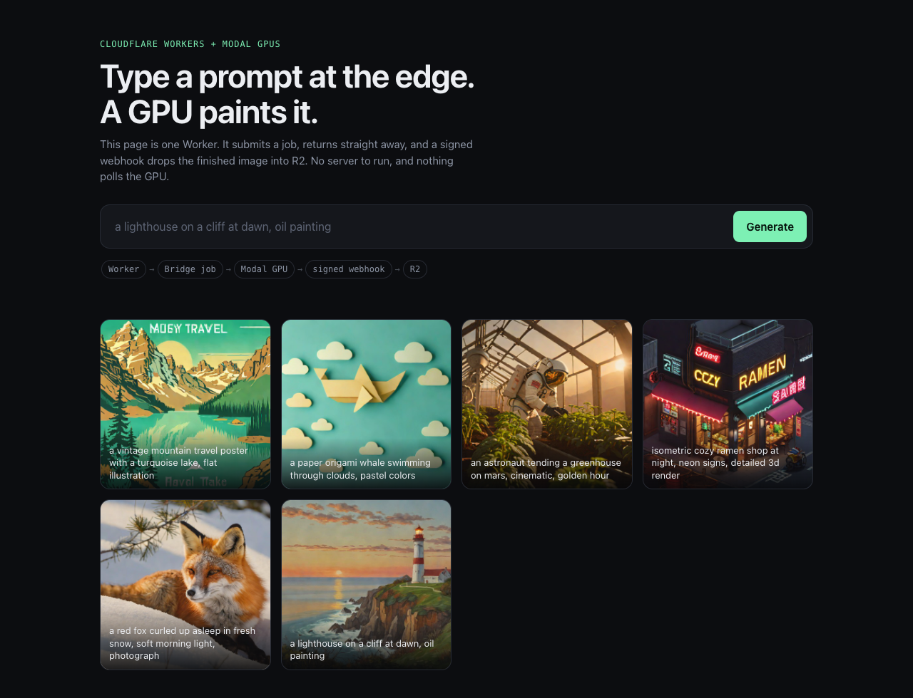
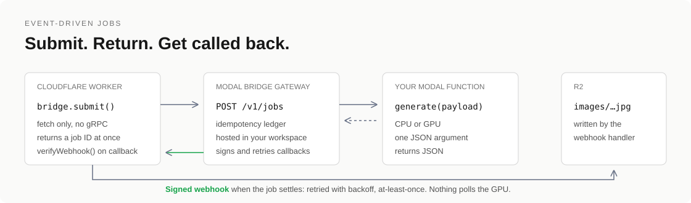

# Modal Bridge

Run GPU-powered background jobs on Modal from Cloudflare Workers, using ordinary `fetch`.
Submit a job, return to your user at once, and receive a signed webhook when it finishes.

An unofficial HTTP gateway plus a dependency-free typed TypeScript client.
Not affiliated with Modal or Cloudflare.

[](https://github.com/lblommesteyn/modal-bridge/actions/workflows/ci.yml)



```ts
import { ModalBridge, verifyWebhook } from "@modal-bridge/client";

// In your Worker: start a GPU job and return immediately.
const bridge = new ModalBridge<Functions>({ url: env.BRIDGE_URL, token: env.BRIDGE_TOKEN });
const job = await bridge.submit("generate", { prompt }, {
  idempotencyKey: requestId,                              // a retry never pays for a second GPU run
  onComplete: { url: "https://my-app.dev/webhooks/modal-bridge" },
});

// Later, in the same Worker: Modal Bridge calls you when the job settles.
const event = await verifyWebhook(request, env.BRIDGE_WEBHOOK_SECRET);
await env.IMAGES.put(`${event.job.id}.jpg`, decode(event.job.result.image_base64));
```

[Quick start](#quick-start) · [Image generation example](#example-image-generation-from-a-worker) · [Callbacks](#completion-callbacks) · [API](#api-and-guarantees) · [Uncertain submissions](#resolving-uncertain-submissions) · [Architecture](docs/architecture.md)

## Why

Modal's official JavaScript SDK talks gRPC and targets Node, Deno and Bun. It does
not run in Cloudflare Workers ([modal-client#4124](https://github.com/modal-labs/modal-client/issues/4124)).
Modal Bridge puts a small HTTP contract in front of your Modal functions:

- **Edge-compatible.** The client is `fetch` and Web Crypto only. No Node compatibility flag.
- **Nothing to host.** The gateway deploys into your own Modal workspace and scales to zero.
- **Idempotent submissions.** Same key and input returns the original job, so retries are safe.
- **Event-driven.** A signed, retried webhook on completion. Polling is optional.
- **Honest about failure.** Uncertain submissions are quarantined and resolved explicitly, never silently re-run.

## Do you need it?

For a single endpoint, **start with Modal's own HTTP support**. A small FastAPI app
hosted on Modal can submit jobs and expose their results without anything else.
Modal documents this [job-processing pattern](https://modal.com/docs/guide/job-queue).

| Your requirement | Simplest fit |
| --- | --- |
| Call one function over HTTP | Modal web endpoint |
| Submit and poll one function | FastAPI hosted on Modal |
| Idempotent submissions, completion webhooks and one typed contract across functions | Modal Bridge |
| Tenant isolation with per-tenant credentials | Not yet; this serves one trusted workspace |

## Quick start

You need [uv](https://docs.astral.sh/uv/), a Modal account (`uvx modal setup`), and a
Modal function that is already deployed. Bridge functions take **one JSON argument**
and return JSON.

```sh
uvx --from git+https://github.com/lblommesteyn/modal-bridge modal-bridge deploy \
  --target my-modal-app/my_function
```

That command checks the function exists, generates a gateway token and webhook
secret, stores them in a Modal Secret, deploys the gateway into your workspace and
prints its URL. Credentials are written to `.modal-bridge.env` (owner-only) and are
never printed. Run it again at any time to add targets; add `--rotate` for new credentials.

```sh
# Run a job end to end from your terminal
uvx --from git+https://github.com/lblommesteyn/modal-bridge modal-bridge call my_function '{"value": 12}'

# Give a Worker the token and webhook secret
modal-bridge worker-secrets ./my-worker --local   # writes .dev.vars for `wrangler dev`
modal-bridge worker-secrets ./my-worker           # `wrangler secret put`, piped so nothing is displayed
```

To scaffold a Worker and deploy the gateway in one step:

```sh
npx create-modal-bridge my-app --target my-modal-app/my_function
```

> The npm packages (`@modal-bridge/client`, `create-modal-bridge`) are prepared in this
> repository but not published yet. Until they are, build the client with `npm run build`
> and install it with `npm pack --workspace @modal-bridge/client`.

### What gets deployed

One Modal app (default name `modal-bridge`) with three CPU functions and two Modal Dicts:

| Piece | Role |
| --- | --- |
| `gateway` | The HTTP API. Scales to zero; several containers can serve at once. |
| `watch` | Waits on each submitted job and delivers its callback the moment it settles. |
| `reconcile` | Runs every minute: settles anything a watcher missed, retries failed callbacks, quarantines crashed submissions. |
| `modal-bridge-jobs`, `modal-bridge-unsettled` | The job ledger. Modal expires entries after 7 idle days, which is the retention period. |

Remove everything with `modal app stop modal-bridge`.

## Example: image generation from a Worker

[`examples/image-gen`](examples/image-gen) is a complete app: one Worker serves the page,
starts SDXL-Turbo on a Modal GPU, and stores the result in R2 when the webhook arrives.



```sh
uv run modal deploy examples/image-gen/modal_app.py           # GPU function; the first build downloads the weights
uv run modal-bridge deploy --target generate=modal-bridge-image-gen/generate --owner-max-active 2
cd examples/image-gen
npx wrangler r2 bucket create modal-bridge-images
uv run modal-bridge worker-secrets . --env-file ../../.modal-bridge.env
# set BRIDGE_URL in wrangler.jsonc to the URL printed by deploy, then:
npx wrangler deploy
```

What it demonstrates:

- **The Worker never waits on the GPU.** `POST /api/generate` returns a job ID in one round trip.
- **The webhook writes to R2.** The browser reads job state from R2, so nothing polls Modal.
- **Retries are free.** The browser's request ID is the idempotency key.
- **Spend is bounded.** `max_containers=1` caps the app at one GPU, and `--owner-max-active`
  limits each visitor (the Worker sends a hashed client ID as `Bridge-Owner`).

The first image after a quiet spell also waits for Modal to boot a container and load the
model. No GPU on your Modal account yet? `IMAGE_GEN_GPU=none modal deploy ...` runs the same
function on CPU (about 20 seconds per image) so you can try the whole flow first.
SDXL-Turbo has its own license; read it before commercial use.

## Completion callbacks

Pass `onComplete: { url }` (HTTP body: `"on_complete": {"url": "..."}`). When the job
reaches `succeeded`, `failed` or `expired`, the gateway POSTs:

```json
{"type": "job.succeeded", "id": "<job id>", "created_at": 1794274299.47,
 "job": {"id": "...", "function": "generate", "status": "succeeded", "result": {}, "completed_at": 1794274299.47}}
```

- **Signed.** Headers follow [Standard Webhooks](https://www.standardwebhooks.com/):
  `webhook-id`, `webhook-timestamp`, and `webhook-signature: v1,<base64 HMAC-SHA256>` over
  `id.timestamp.body`. Verify with `verifyWebhook(request, secret)`, or any Standard Webhooks library.
- **Retried.** Any non-2xx response or network error is retried after 10 s, 1 min, 5 min,
  30 min, 2 h, 6 h and 24 h. After eight attempts the callback is marked `failed`;
  the job and its result remain readable by ID. Delivery state is durable and visible as `job.callback`.
- **At-least-once.** A redelivery carries the same `webhook-id`. Make handlers idempotent.
- **Restricted.** URLs must be HTTPS (HTTP only for localhost), are never redirected, and can
  be limited with `--callback-hosts 'my-app.dev,*.workers.dev'`. Callers hold the gateway
  token, so treat callback URLs as trusted-workspace input and set the allowlist in production.

Callbacks are not sent for `submission_unknown`; that state is returned by the submit call
itself and listed for operators (below). A cancelled job still gets exactly one callback
with its real outcome.

## API and guarantees

| Route | Purpose |
| --- | --- |
| `POST /v1/jobs` | Submit `{function, input, on_complete?}`; requires `Idempotency-Key`; optional `Bridge-Owner`; returns 202 |
| `GET /v1/jobs/{id}` | Read a job; refreshes pending work from Modal and caches the result |
| `GET /v1/jobs?status=&owner=&limit=` | List jobs, newest first, without results |
| `POST /v1/jobs/{id}/cancel` | Request cancellation without terminating shared containers |
| `POST /v1/jobs/{id}/resolve` | Settle an uncertain submission: `attach`, `resubmit` or `abandon` |
| `GET /v1/metrics` | Job and callback counts, Modal call latency, concurrency saturation |
| `GET /health` | Process liveness; does not check Modal connectivity |

Every route except `/health` requires the gateway bearer token, and a token grants access
to all jobs. Interactive docs are served at `/docs`; the contract is checked in as
[`docs/openapi.json`](docs/openapi.json). Input and serialized output are limited to 1 MiB:
return object-storage references for larger artifacts. Non-JSON or oversized results become
failed jobs even though the computation may have succeeded.

| Status | Final? | Meaning |
| --- | --- | --- |
| `submitting` | no | Key reserved; spawn not yet recorded |
| `pending` | no | No result yet; does not distinguish queued from running |
| `cancel_requested` | no | Modal accepted cancellation; the job can still succeed, fail or expire |
| `succeeded` | yes | JSON result cached |
| `failed` | yes | Execution or result contract failed; inspect Modal logs with `call_id` |
| `expired` | yes | Modal's output expired before the gateway cached it |
| `submission_unknown` | until resolved | Spawn or recording failed; work may already exist |

Each job also reports `target` (the Modal app/function its alias resolved to), `call_id`,
`owner`, `created_at`, `submitted_at`, `completed_at`, `updated_at` and `callback` state.
`completed_at` is when the gateway recorded the outcome, not when Modal finished.

**Idempotency.** Same key and same input returns the original job. Same key with a
different input, callback URL or owner returns 409. The gateway stores input hashes, not
input bodies. There is no exactly-once guarantee: your functions must tolerate repeated
execution where it matters.

**Cancellation.** `cancel_requested` is not a final state. `wait()` and callbacks keep going
until the job is truly settled: normally `failed`, or `succeeded` if it finished first.

**Quotas.** `--owner-max-active` and `--owner-max-daily` cap jobs per `Bridge-Owner` value
and return 429. They count jobs, not dollars; cap spend with `max_containers` on your Modal
functions. Replays of an existing key are never throttled. On the Modal-hosted ledger the
daily counter is approximate under heavy concurrency.

**Back-pressure.** At most `BRIDGE_MAX_MODAL_CONCURRENCY` (default 32) Modal SDK calls run
per gateway process. Beyond that, requests wait up to five seconds and then get 503 with
`Retry-After`, before any key is reserved. `scripts/load_test.py` measures this offline.

**Other limits.** A built-in Python `TimeoutError` raised by your function is
indistinguishable from an empty poll: raise a different exception type. Types in the
client are compile-time only; validate important results at runtime.

## Resolving uncertain submissions

The ledger and Modal cannot commit atomically. If a spawn call errors, or the gateway
dies between reserving a key and recording the Modal call, the job becomes
`submission_unknown` (reservations stuck in `submitting` are moved there after two
minutes). Nothing is re-run automatically. Instead:

```ts
const stuck = await bridge.list({ status: "submission_unknown" });
// Look in the Modal dashboard for a call to stuck[0].target around stuck[0].created_at, then:
await bridge.resolve(id, { action: "attach", call_id: "fc-..." });      // found it: track that call
await bridge.resolve(id, { action: "abandon" });                         // it never ran: mark failed
await bridge.resolve(id, { action: "resubmit", input: originalInput });  // run it (again)
```

`attach` verifies the call ID with Modal first. `resubmit` is the only action that can
execute work twice, so it requires the original input and checks it against the stored
hash. Each resolution is a compare-and-set, and the job then continues normally,
including its callback.

## TypeScript client

```ts
type Functions = { square: { input: { value: number }; output: { value: number } } };
const bridge = new ModalBridge<Functions>({ url: env.BRIDGE_URL, token: env.BRIDGE_TOKEN });

const job = await bridge.submit("square", { value: 12 }, { idempotencyKey: "order-1841" });
const current = await bridge.get(job.id);
const result = await bridge.wait<{ value: number }>(job.id, { timeoutMs: 30_000 }); // scripts and short jobs
await bridge.cancel(job.id);
```

A `wait` timeout or abort stops local waiting; it does not cancel remote work. Network and
HTTP errors are surfaced, not retried silently: retry a submission with the **same**
idempotency key and input. Keep the token in server-side secrets, never in browser code.

## Self-hosting with SQLite

The Modal-hosted gateway is the default. Run your own host when you want the full job
history in SQL, a configurable retention period, or batch runs.

```sh
cp .env.example .env    # fill in the placeholders
docker compose up --build -d
```

Compose starts the API and a `runner` process that settles jobs, delivers callbacks and
applies `BRIDGE_RETENTION_DAYS`. It binds to localhost: put an HTTPS reverse proxy in
front. Keep the `bridge-data` volume on persistent local disk, run one replica, and back
it up; results can contain sensitive data. A v0.1 database is upgraded in place on start.
Purging a settled job frees its idempotency key.

This mode also exposes `/v1/runs`: versioned batch manifests with per-run concurrency,
pause and resume, reuse of earlier successes, and retry of confirmed failures. See
`/docs` on a running gateway.

## Development

```sh
uv sync --frozen && npm ci
uv run pytest -q                          # gateway, both ledgers, fake Modal; no credentials needed
npm test && npm run test:workers          # client, including the real Workers runtime
uv run python scripts/export_openapi.py   # after changing routes or models
uv run python scripts/load_test.py        # offline latency and back-pressure check
```

For a live check against real Modal CPU functions, deploy `examples/modal_app.py`, run
`scripts/setup_local.py`, start `uvicorn modal_bridge.app:from_env --factory`, and run
`BRIDGE_URL=http://127.0.0.1:8000 uv run python scripts/smoke_live.py`.
`modal_bridge.demo:create_demo_app` is an offline simulator for trying Swagger without an account.

## Scope and roadmap

Modal Bridge serves a single trusted workspace: one token, one set of functions.
Modal output deserialization trusts your allowlisted functions. It is not an
untrusted-code execution API.

Next: artifact upload helpers for results over 1 MiB, opt-in input capture for replay,
runtime result schemas, per-tenant keys, and a PostgreSQL ledger if multi-region
self-hosting turns out to matter.

Contributions are welcome: keep them focused and include failure-path tests for changes
to submission, cancellation, callbacks or persistence. Report security issues privately
to the maintainer.

## References

- [Modal FunctionCall API](https://modal.com/docs/sdk/py/latest/FunctionCall) · [Modal Dicts](https://modal.com/docs/guide/dicts-and-queues)
- [Reported Workers SDK transport limitation](https://github.com/modal-labs/modal-client/issues/4124)
- [Standard Webhooks](https://www.standardwebhooks.com/)

MIT licensed.
