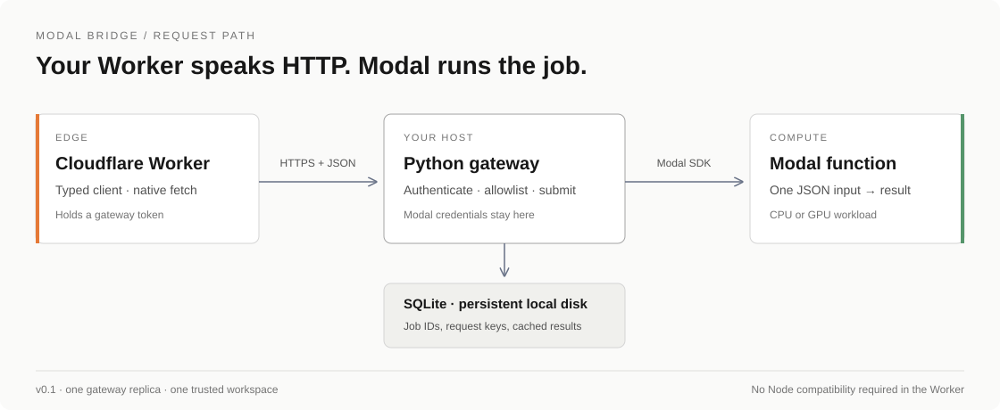
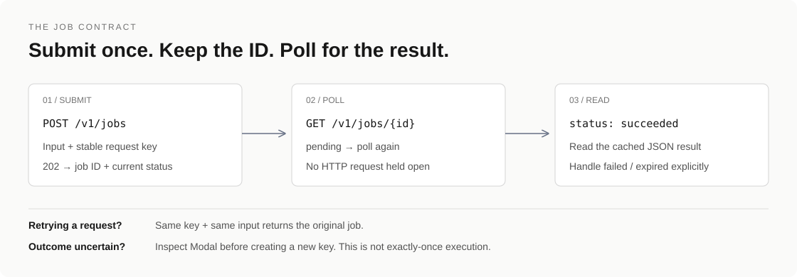

# Modal Bridge

Call allowlisted Modal functions from Cloudflare Workers using ordinary `fetch`.
An unofficial, self-hosted HTTP gateway and dependency-free typed TypeScript client.
Not affiliated with Modal or Cloudflare. Self-hosted v0.1; the client is not published to npm yet.

[](https://github.com/lblommesteyn/modal-bridge/actions/workflows/ci.yml)



[Quick start](#quick-start) · [Try Swagger](#try-the-api-in-swagger) · [TypeScript](#typescript) · [API contract](docs/openapi.json) · [Architecture](docs/architecture.md)

## Do you need a gateway?

For a single endpoint, **start with Modal's own HTTP support**. A small FastAPI app
hosted on Modal can submit jobs and expose their results without another server.
Modal already documents this [job-processing pattern](https://modal.com/docs/guide/job-queue).

Use this gateway when you want persistent request-key deduplication, a shared
function allowlist, and cached results behind one HTTP contract. Its cost is another
service to operate and one extra network hop. The current SQLite implementation
runs on a regular Python host with persistent local disk.

| Your requirement | Simplest fit |
| --- | --- |
| Call one function over HTTP | Modal Web Function |
| Submit and poll asynchronous work | FastAPI hosted on Modal |
| Persistent deduplication and result caching across functions | Modal Bridge |
| Multiple gateway replicas or tenant isolation | A future shared-store design; not v0.1 |

See the [architecture decision](docs/architecture.md) for trade-offs and the next
serverless deployment option. Modal credentials stay on the gateway; the Worker
holds a separate gateway token.

## Included

- Fetch-only TypeScript client: typed submissions, status, bounded polling, cancellation.
- Authenticated FastAPI gateway with a server-controlled function allowlist.
- Persistent SQLite job IDs, result caching and atomic idempotency reservations.
- CPU-only Modal example and a protected Cloudflare Worker example.
- Swagger UI with bearer authorization, request examples and typed response schemas.
- Unit/API tests, Wrangler bundle check, Docker configuration and CI.

## Quick start

Requires Python 3.12+, uv, and Node 22+. From the repository root:

```sh
uv sync --frozen
npm ci
npm run build
uv run modal setup
uv run modal deploy examples/modal_app.py
```

The last two commands authenticate and deploy a small CPU function to your Modal
account. Calling it incurs normal Modal usage. No GPU is required.

Run the gateway in a terminal with your Modal credentials configured:

```sh
uv run python scripts/setup_local.py
uv run uvicorn modal_bridge.app:from_env --factory --host 127.0.0.1 --port 8000
```

The setup command generates a random gateway token in `.env` with owner-only file permissions; it never prints the token. `.env` is ignored by Git. The gateway loads that file automatically and uses your active Modal profile. For hosted deployments, use `MODAL_TOKEN_ID` and `MODAL_TOKEN_SECRET` instead.

The gateway creates `data/jobs.sqlite`. Configure
`BRIDGE_DB` to use another persistent path. Do not put this database on an ephemeral
serverless filesystem or a network filesystem. Use one gateway replica for v0.1.

In another terminal, load the token from `.env` without displaying it, then submit a job:

```sh
export BRIDGE_TOKEN="$(uv run python -c 'from dotenv import dotenv_values; print(dotenv_values(".env")["BRIDGE_TOKEN"])')"
curl http://127.0.0.1:8000/v1/jobs \
  -H "Authorization: Bearer $BRIDGE_TOKEN" \
  -H 'Idempotency-Key: square-demo-001' \
  -H 'Content-Type: application/json' \
  -d '{"function":"square","input":{"value":12}}'
```

Copy the returned `id` into `GET /v1/jobs/<id>` with the same Authorization header.
The successful result is `{"value":144}`. Interactive API docs: `/docs`.

## Try the API in Swagger

Open [Swagger UI](http://127.0.0.1:8000/docs) after starting the real gateway.
Click **Authorize** and enter your `BRIDGE_TOKEN` from the private `.env` file,
without the `Bearer` prefix. There is no shared production token.

1. Open **POST /v1/jobs**, choose **Try it out**, and use the square example with
   `Idempotency-Key: square-first-request`.
2. Execute and copy the returned `id`.
3. Poll **GET /v1/jobs/{job_id}** until the result is `{"value":144}`.
4. Resubmit the same input and key to receive the same job ID. Changing input with
   that key returns a `409` conflict.

These requests execute real Modal functions and incur normal compute usage.
The gateway also serves `/redoc` and `/openapi.json`. Job routes require bearer
authentication; documentation is public. Swagger does not persist tokens across
reloads. UI assets load from a CDN. You can import the checked-in
[OpenAPI contract](docs/openapi.json) into other API clients.

## TypeScript

The workspace already links the client locally. For another repository, run
`npm pack --workspace @modal-bridge/client` after building and install the resulting
tarball. The package name is provisional, not an existing published dependency.

```ts
import { ModalBridge } from "@modal-bridge/client";

type Functions = {
  square: { input: { value: number }; output: { value: number } };
};
const bridge = new ModalBridge<Functions>({
  url: env.BRIDGE_URL,
  token: env.BRIDGE_TOKEN,
});
const job = await bridge.submit("square", { value: 12 }, {
  idempotencyKey: "customer-request-unique-id",
});
const current = await bridge.get<{ value: number }>(job.id);
// For scripts or short jobs; HTTP handlers should normally return the job ID.
const result = await bridge.wait<{ value: number }>(job.id, { timeoutMs: 30_000 });
// await bridge.cancel(job.id);
```

Types are compile-time assistance, not runtime result validation. Validate important
results in your application. `wait` timeout or abort stops local waiting; it does not
cancel remote work. Network/HTTP errors are returned to the caller, not retried
silently. Retry submission using the **same** idempotency key and input.

## Cloudflare Worker example

1. Set `BRIDGE_URL` in `examples/worker/wrangler.jsonc` to your gateway's HTTPS URL.
2. From `examples/worker`, run `npx wrangler secret put BRIDGE_TOKEN` and enter the
   gateway token. Run `npx wrangler secret put EXAMPLE_TOKEN` with a different random
   token for callers of this example.
3. From the repository root run `npm run build`, then
   `npm run deploy --workspace modal-bridge-worker-example`.
4. Send `POST /jobs` with `{"value":12}`, `Authorization: Bearer <EXAMPLE_TOKEN>`,
   and `Idempotency-Key`. Poll `GET /jobs/<id>` or `POST /jobs/<id>/cancel`.

For local Wrangler development, store these secrets in
`examples/worker/.dev.vars` (ignored by git), and use a localhost gateway URL.
This example uses one shared caller identity. It does not implement tenant isolation;
add per-user authorization and job ownership checks before exposing a multi-user API.

## API and guarantees



| Route | Purpose |
| --- | --- |
| `GET /health` | Process liveness; does not check Modal connectivity |
| `POST /v1/jobs` | Submit `{function,input}`; requires `Idempotency-Key`; returns 202 |
| `GET /v1/jobs/{id}` | Poll and cache a completed JSON result |
| `POST /v1/jobs/{id}/cancel` | Request cancellation without terminating shared containers |

All job routes require the gateway bearer token. A token grants access to all jobs
in this gateway. Function aliases resolve to `[Modal app name, function name]` in
`BRIDGE_TARGETS`. Functions take **one JSON argument** and return JSON. Input and
serialized output limits are 1 MiB. For large artifacts, return R2/S3 references.
Non-JSON/oversized results become failed jobs; the original computation may have succeeded.

| Status | Meaning |
| --- | --- |
| `submitting` | Reservation created; spawn not yet recorded |
| `pending` | No result available; does not distinguish queued from running |
| `succeeded` | JSON result cached durably |
| `failed` | Execution or result contract failed; inspect Modal logs |
| `expired` | Modal output expired before the gateway cached it |
| `cancel_requested` | Modal accepted cancellation; completion can still race |
| `submission_unknown` | Spawn or recording failed; work may already exist |

Same key + same input returns the original job. Same key + different input returns
409. Keys remain reserved for the lifetime of the database. The gateway stores input
hashes, not input bodies. There is no automatic replay, input archive, or exactly-once
execution guarantee. Your functions must tolerate repeated execution where needed.

**Crash boundary:** SQLite and Modal cannot commit atomically. If the gateway dies
between reserving a key and recording a Modal call ID, the job remains `submitting`.
If a caught submission error occurs, it becomes `submission_unknown`. Neither is
silently resubmitted. Inspect the corresponding Modal app and reconcile manually
before using a new key. A client HTTP timeout does not prove submission failed.

Results are refreshed on GET, not by a background reconciler. Poll before Modal's
output retention expires. Cancellation is a request, not proof that side effects
were stopped; a canceled call can later appear failed or expired through Modal's
result API. Built-in Python `TimeoutError` from a user function is indistinguishable
from an empty poll through this adapter: use a different application exception type.

## Deploying the gateway

Copy `.env.example` to `.env`, replace all placeholders, then:

```sh
docker compose up --build -d
```

Compose binds to localhost. Put an HTTPS reverse proxy in front of it for remote
Workers. Preserve the `bridge-data` volume. The image runs as a non-root user.
Protect the gateway token as a backend secret; never put it in browser JavaScript.
Use access controls and rate limits at your reverse proxy. Back up the database;
results can contain sensitive data. Modal output deserialization trusts your
allowlisted functions and workspace. This is not an untrusted-code execution API.

## Development and validation

```sh
uv run pytest -q
uv run python scripts/export_openapi.py
npm test
npm run test:workers
cd examples/worker
npx wrangler deploy --dry-run
```

Unit tests use fake Modal calls and require no credentials or paid compute.
For an end-to-end check, deploy `examples/modal_app.py`, run `scripts/setup_local.py`,
start the gateway, and run:

```sh
BRIDGE_URL=http://127.0.0.1:8000 uv run python scripts/smoke_live.py
```

This invokes real CPU functions and checks success, duplicate submissions, conflicts,
remote failure and cancellation. It requires the square, fail and slow aliases set
by the setup script. The test-only simulator remains available through
`modal_bridge.demo:create_demo_app` for offline development, but is never selected
by the gateway entrypoint.

 Adapter tests
exercise the installed SDK's exception classes. A successful dry-run checks bundling,
not a live Cloudflare deployment. Repeat live checks in your target deployment environment before production use.

## Current scope

This release supports a single trusted workspace on one persistent gateway host.
A public GitHub repository does not host your gateway. Use Docker on an HTTPS host
for an internet-facing API; the Worker must point to that host rather than localhost.

## Next milestones

- Authenticated completion callbacks with delivery retries.
- Opt-in input capture, failure inspection and explicit replay.
- R2 artifact example and runtime schemas.
- PostgreSQL support, per-tenant keys, retention policies and operational metrics.

Keep contributions focused; include failure-path tests for changes to submission,
cancellation or persistence. Report security issues privately to the repository
maintainer rather than posting credentials or sensitive job contents in an issue.

## References

- [Modal FunctionCall API](https://modal.com/docs/sdk/py/latest/FunctionCall)
- [Modal Function lookup](https://modal.com/docs/guide/function-lookup)
- [Reported Workers SDK transport limitation](https://github.com/modal-labs/modal-client/issues/4124)

MIT licensed.
